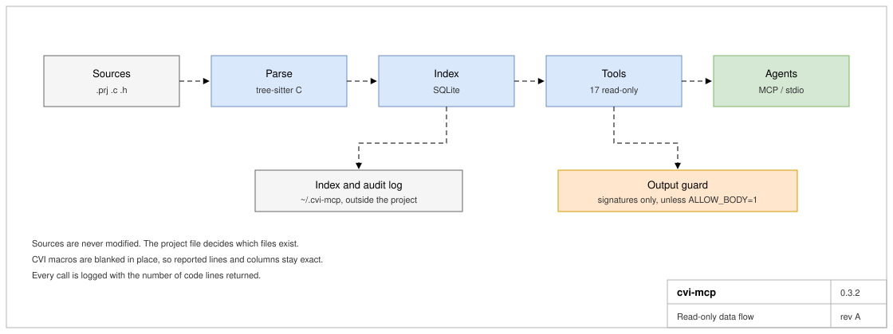

<p align="center">
  
</p>

<p align="center">
  
  
  
  
</p>

<p align="center">
  <b>English</b> &nbsp;·&nbsp; <a href="../../wiki/Home-fr">Français</a> &nbsp;·&nbsp; <a href="../../wiki">Wiki</a>
</p>

Understand an unfamiliar LabWindows/CVI codebase by asking questions instead of
grepping through fifty files. `cvi-mcp` replays the preprocessor with the
`.prj` settings, indexes the compiled C, reconstructs the UI wiring, finds
risks, leaks and dead code, simulates another configuration, looks up the NI
SDK, reports build errors and compares two versions.

It never writes to your sources, the index lives outside the project, and by
default no function body ever leaves your machine.

Quick start
===============================================================================

```bash
pip install -e .
cvi-mcp --check
```

`--check` prints what your machine actually offers: detected CVI installations
whatever their year, SDK headers, build executable, active settings. It exits
non-zero when something needs your attention !

Then point it at a project and connect it to a client:

```bash
export CVI_MCP_PROJECT=/path/to/project    # Windows: set CVI_MCP_PROJECT=C:\projects\app
```

Connect it
===============================================================================

Claude Code, `.mcp.json` at the repository root:

```json
{
  "mcpServers": {
    "cvi": {
      "command": "cvi-mcp",
      "env": { "CVI_MCP_PROJECT": "C:\\projects\\app" }
    }
  }
}
```

OpenCode, Claude Desktop and the CLI form are in
[Home](../../wiki/Home). Watch out for one trap: OpenCode nests servers under
`mcp.servers`, takes the command as an array, and names the variables block
`environment`, not `env`.

Tools
===============================================================================

| Group | Tools |
|---|---|
| Environment | `cvi_environment`, `self_check`, `use_project`, `reindex` |
| Reading | `project_overview`, `list_symbols`, `find_symbol`, `get_function`, `find_usages`, `call_graph`, `file_outline` |
| Search and impact | `search_text`, `find_by_topic`, `related`, `series`, `impact`, `peek` |
| Build configuration | `config_map`, `macro_usages`, `config_diff` |
| User interface | `ui_map` |
| Quality and risks | `dead_code`, `lock_check`, `risks`, `consistency`, `complexity`, `module_graph`, `threads` |
| I/O and persistence | `call_sites`, `persistence` |
| SDK and build | `sdk_index`, `sdk_lookup`, `build_check` |
| Versions | `snapshot_save`, `snapshot_list`, `snapshot_delete`, `diff_versions`, `history` |

Every answer is about the code that is actually compiled: `#if` are evaluated
with the `.prj` defines and build configuration, and excluded code is set
aside. Long lists are paginated, answers stay under a size budget, and an
empty result says why.

A few answer questions that are otherwise painful. `ui_map` tells you which
button triggers which callback and what that callback calls. `impact` gives
the checklist to extend a feature, numbered series to prolong included.
`config_diff` shows what changes if a macro takes another value, without
touching a file. `diff_versions` sums up two versions in a few sentences.

How it works
===============================================================================

<p align="center">
  
</p>

No CVI version is hardcoded. Installations are found by globbing `CVI*` under
the National Instruments roots and the year is read from the folder name, so
2017, 2019, 2020 and any later release are handled the same way. Sources are
decoded as UTF-8 then cp1252, which is what a French CVI actually writes, and
CRLF and LF produce the same body fingerprint so a file reopened in another
editor does not show up as modified.

Documentation
===============================================================================

Three pages per language, no more.

| Page | English | Français |
|---|---|---|
| Install, connect, configure | [Home](../../wiki/Home) | [Accueil](../../wiki/Home-fr) |
| The 38 tools | [Tools](../../wiki/Tools) | [Outils](../../wiki/Tools-fr) |
| Design, limits, troubleshooting | [Internals](../../wiki/Internals) | [Fonctionnement](../../wiki/Internals-fr) |

The wiki sources live in `wiki/`. To publish them:

```bash
git clone https://github.com/<owner>/cvi-mcp.wiki.git
cp wiki/*.md cvi-mcp.wiki/ && cd cvi-mcp.wiki && git add . && git commit -m "docs" && git push
```

External references: [LabWindows/CVI Help](https://www.ni.com/docs/en-US/bundle/labwindows-cvi/page/cvi/intro.htm)
· [CVI manuals](https://ni.com/r/cvimanuals)
· [MCP](https://modelcontextprotocol.io)
· [Claude Code MCP](https://code.claude.com/docs/en/mcp)
· [OpenCode MCP](https://opencode.ai/docs/mcp-servers)
· [tree-sitter](https://tree-sitter.github.io/tree-sitter/)

Development
===============================================================================

```bash
pip install -e ".[dev]"
pytest
ruff check src tests scripts
```

`pytest` checks the source tree. To check the shipped artifact instead, build
the archive and run the acceptance recipe: it extracts it, installs into a
clean virtual environment, runs the suite there, then speaks MCP over stdio and
calls the tools for real.

```bash
tar czf cvi-mcp.tar.gz cvi-mcp/
python scripts/acceptance.py cvi-mcp.tar.gz
```

Every file header carries its role, its real state (`stable`, `tolerant` or
`heuristique`) and the package version at its last change.
